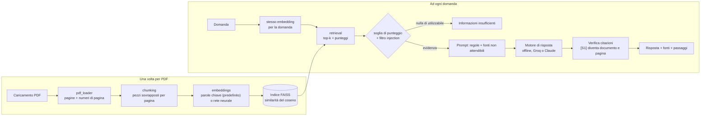

# Industrial RAG Assistant

[English](README.md) | Italiano

Fai domande sui manuali tecnici industriali (PDF) e ricevi risposte che **citano il documento e la pagina** da cui vengono. Se i documenti non contengono la risposta, l'assistente lo dice invece di inventare.


## Perché

Un modello linguistico generico a cui chiedi una coppia di serraggio produce volentieri un numero plausibile. In manutenzione, un numero plausibile ma inventato è pericoloso. Questo progetto costruisce un sistema RAG (Retrieval-Augmented Generation) dai suoi pezzi di base (niente LangChain, niente LlamaIndex) e punta sulla **verificabilità**: ogni risposta è legata a una fonte che puoi aprire, e la qualità è misurata, non data per scontata.

## Cosa fa

- Carichi PDF in un'app Streamlit (italiano o inglese). Restano in memoria e non vengono mai salvati.
- Ogni passaggio conserva nome del documento e numero di pagina. Due metodi di ricerca: **parole chiave** (predefinito, leggero) o **rete neurale** (embedding multilingue, opzionale).
- Le risposte vengono solo dai passaggi trovati. Le citazioni sono **verificate** sui passaggi realmente trovati, e quando i documenti non rispondono l'app dice «informazioni insufficienti».
- Le istruzioni nascoste in un PDF (prompt injection) vengono filtrate; se due documenti si contraddicono, si riportano entrambi i valori.
- Anteprima della pagina con la frase usata evidenziata, e un promemoria per verificare i valori tecnici (coppie, pressioni...).
- Tre motori di risposta: **offline** (copia frasi, senza chiave), **Groq** (chiave gratuita di prova) e **Claude** (chiave Anthropic).
- Quattro schede: Assistente, Come funziona, Passo per passo (i dati veri di ogni fase per la tua domanda), Architettura.
- 328 test che girano offline, senza rete e senza chiavi.

## Avvio rapido

Serve Python 3.10 o superiore (sviluppato con 3.12).

```bash
git clone https://github.com/sartorelliriccardo/industrial-rag-assistant
cd industrial-rag-assistant
python -m venv .venv
# Windows: .venv\Scripts\activate      macOS/Linux: source .venv/bin/activate
pip install -e ".[app,dev]"
streamlit run app/streamlit_app.py
```

Carica i tuoi manuali PDF nella barra laterale, oppure quelli inventati in `data/sample_pdfs/`, e chiedi per esempio: *Qual è la coppia di serraggio del dado della girante?* Il motore offline non richiede nessuna chiave.

Per usare un vero modello linguistico, sceglilo nella barra laterale e incolla una chiave (resta solo in memoria): una chiave gratuita da [console.groq.com/keys](https://console.groq.com/keys) per **Groq**, oppure una chiave Anthropic per **Claude**. Si possono anche impostare con `GROQ_API_KEY` / `ANTHROPIC_API_KEY`. Dettagli e avvertenze: [docs/DETAILS.md](docs/DETAILS.md) (in inglese).

## Architettura



Il metodo di ricerca e il motore di risposta sono scelte indipendenti. La **ricerca per parole chiave** pesa di più le parole rare e non usa nessun modello (circa 225 MB per tutta l'app). La **ricerca neurale** usa un piccolo modello multilingue (118 MB, circa 400 MB di memoria in più) che confronta i significati. Il modello che scrive la risposta vede solo i passaggi numerati e deve citarli come `[S1]`. Il codice riporta ogni id a un documento e a una pagina reali, e segnala le risposte senza nessuna citazione valida.

Tabella dei moduli e scelte di progetto: [docs/DETAILS.md](docs/DETAILS.md) (in inglese), e la guida di studio in italiano [docs/STUDY_GUIDE.md](docs/STUDY_GUIDE.md).

## Quanto funziona bene?

- **Benchmark sintetico** (43 domande su 4 documenti inventati, motore offline, ricerca per parole chiave): la pagina giusta è al primo posto nel 97% dei casi, l'89% delle risposte è corretto e 7 domande su 8 senza risposta vengono rifiutate. Le domande le ho scritte io e le soglie le ho regolate su quelle stesse domande: i numeri sono **ottimistici**.
- **Un manuale vero** (manuale italiano di 40 pagine di una macchina da caffè, 12 domande scritte da me, risposte valutate da me):

| Risposte utili su 12 | Parole chiave | Rete neurale |
|---|---|---|
| Motore offline | 5 | 2 |
| Groq, `gpt-oss-120b` | **10** | 7 (+2 in parte giuste) |

  Le 3 domande su cose che il manuale non tratta sono state rifiutate in ogni configurazione.
- **Cosa ho imparato.** Un modello linguistico risolve gran parte del problema delle risposte (da 5 a 10). La ricerca neurale qui non ha aiutato: ha trovato la pagina giusta meno spesso (8 su 12 contro 11 su 12). Le mie domande riusano le parole del manuale, il che favorisce le parole chiave, quindi sinonimi e domande in un'altra lingua non sono stati provati.
- **Cosa ancora non va.** Quando il passaggio giusto non viene trovato, il modello può rispondere in modo sbagliato e sicuro. Il controllo delle citazioni verifica che la fonte esista, non che sostenga la frase.

Un manuale, una prova, valutata da me: va letta come una prima misura, non come una garanzia. Tabelle complete, errori e metodo: [docs/DETAILS.md](docs/DETAILS.md) (in inglese).

## Limiti

- I PDF scansionati vengono rifiutati (niente OCR); figure e schemi sono invisibili; le tabelle perdono la struttura.
- Le difese dalla prompt injection sono euristiche e si possono aggirare.
- Il motore Claude è implementato e provato con un finto fornitore, ma non valutato sull'API vera.
- L'indice vive nella sessione: non c'è persistenza, e la ricerca esatta non regge raccolte molto grandi.
- **Non per decisioni critiche per la sicurezza:** controlla sempre la pagina citata.

## Riservatezza

- I documenti restano solo nella memoria del server: non vengono mai scritti su disco né nei log. Vengono cancellati con un pulsante, dopo 15 minuti senza interazione, e circa 15-20 secondi dopo la chiusura della pagina.
- Con Groq o Claude, la domanda e i passaggi trovati (non l'intero PDF) vengono inviati a quel servizio. Il motore offline non invia nulla da nessuna parte.
- La demo pubblica gira su una piattaforma di terzi che questo progetto non controlla, e le app Streamlit pubbliche sono indicizzate dai motori di ricerca. **Non caricare documenti riservati.** Per quelli, usa l'app sul tuo computer. Una `APP_PASSWORD` facoltativa limita l'accesso.

Come è stato misurato e cosa non garantisce: [docs/DETAILS.md](docs/DETAILS.md) (in inglese).

## Struttura del progetto

```
app/                 pagina Streamlit e un file per ogni parte (barra laterale, schede, riservatezza)
src/rag_assistant/   la libreria: lettura, pezzi, indice, ricerca, risposta, controlli
tests/               test pytest offline
eval/                domande e risultati della valutazione
data/sample_pdfs/    manuali inventati per provare l'app e per i test
docs/                DETAILS.md (dettaglio completo, inglese), STUDY_GUIDE.md (italiano)
```

## Licenza

MIT, vedi [LICENSE](LICENSE). I documenti di esempio sono inventati per questo progetto.
