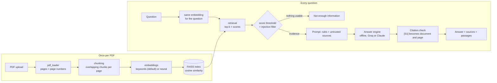

# Industrial RAG Assistant

English | [Italiano](README.it.md)

Ask questions about industrial technical manuals (PDF) and get answers that **cite the document and page** they came from. If the documents do not contain the answer, the assistant says so instead of guessing.


## Why

A general-purpose LLM asked for a tightening torque will happily produce a plausible number. In maintenance, a plausible but invented number is dangerous. This project builds Retrieval-Augmented Generation (RAG) from its basic parts (no LangChain, no LlamaIndex) and focuses on **verifiability**: every answer is tied to evidence you can open, and quality is measured, not assumed.

## What it does

- Upload PDFs in a Streamlit app (Italian or English). They are processed in memory and never stored.
- Every passage keeps its document name and page number. Two search methods: **keywords** (default, light) or **neural** (multilingual embeddings, optional).
- Answers come only from the retrieved passages. Citations are **checked** against the passages really retrieved, and when the documents do not answer, the app says "not enough information".
- Instructions hidden in a PDF (prompt injection) are filtered; two documents that disagree are both reported.
- Page preview with the used sentence highlighted, and a reminder to verify technical values (torque, pressure...).
- Three answer engines: **offline** (copies sentences, no key), **Groq** (free test key) and **Claude** (Anthropic key).
- Four tabs: Assistant, How it works, Step by step (the real data of every stage for your question), Architecture.
- 328 tests that run offline, with no network and no keys.

## Quick start

Requires Python 3.10+ (developed on 3.12).

```bash
git clone https://github.com/sartorelliriccardo/industrial-rag-assistant
cd industrial-rag-assistant
python -m venv .venv
# Windows: .venv\Scripts\activate      macOS/Linux: source .venv/bin/activate
pip install -e ".[app,dev]"
streamlit run app/streamlit_app.py
```

Upload your PDF manuals in the sidebar, or the invented ones in `data/sample_pdfs/`, and ask for example: *What is the tightening torque of the impeller nut?* The offline engine needs no key.

To use a real language model, choose it in the sidebar and paste a key (kept in memory only): a free key from [console.groq.com/keys](https://console.groq.com/keys) for **Groq**, or an Anthropic key for **Claude**. Both can also be set with `GROQ_API_KEY` / `ANTHROPIC_API_KEY`. Details and caveats: [docs/DETAILS.md](docs/DETAILS.md).

## Architecture



The search method and the answer engine are independent choices. **Keyword search** weighs rare words and uses no model (about 225 MB for the whole app). **Neural search** uses a small multilingual model (118 MB, about 400 MB more memory) that compares meaning. The model that writes the answer sees only the numbered passages and must cite them as `[S1]`. The code maps each id back to a real document and page, and flags answers with no valid citation.

Module-by-module table and design decisions: [docs/DETAILS.md](docs/DETAILS.md).

## How well does it work?

- **Synthetic benchmark** (43 questions over 4 invented documents, offline engine, keyword search): the right page ranks first 97% of the time, 89% of answers are correct and 7 of 8 unanswerable questions are refused. I wrote the questions and tuned the thresholds on them, so these numbers are **optimistic**.
- **One real manual** (a 40-page Italian coffee-machine manual, 12 questions I wrote, answers graded by me):

| Useful answers out of 12 | Keyword search | Neural search |
|---|---|---|
| Offline engine | 5 | 2 |
| Groq, `gpt-oss-120b` | **10** | 7 (+2 partly right) |

  All 3 questions the manual does not cover were refused in every setup.
- **What it taught me.** A language model fixes most of the answering problem (5 to 10). Neural search did not help here: it found the right page less often (8 of 12 against 11 of 12). My questions reuse the manual's words, which favours keywords, so synonyms and questions in another language are untested.
- **What still fails.** When the right passage is not retrieved, the model can answer wrongly with confidence. The citation check verifies that the source exists, not that it supports the sentence.

One manual, one run, my own grading: treat it as a first measurement, not a guarantee. Full tables, failures and method: [docs/DETAILS.md](docs/DETAILS.md).

## Limits

- Scanned PDFs are rejected (no OCR); figures and diagrams are invisible; tables lose their structure.
- Prompt-injection defences are heuristic and can be bypassed.
- The Claude engine is implemented and tested against a fake provider, but not evaluated on the live API.
- The index lives in the session: there is no persistence, and exact search will not scale to very large collections.
- **Not for safety-critical decisions:** always check the cited page.

## Privacy

- Documents stay in the server's memory only: they are never written to disk or to logs. They are deleted by a button, after 15 minutes without interaction, and about 15 to 20 seconds after the page is closed.
- With Groq or Claude, the question and the passages found (not the whole PDF) are sent to that service. The offline engine sends nothing anywhere.
- The public demo runs on a third-party platform this project does not control, and public Streamlit apps are indexed by search engines. **Do not upload confidential documents.** For those, run the app on your own machine. An optional `APP_PASSWORD` restricts access.

How this was measured and what it does not guarantee: [docs/DETAILS.md](docs/DETAILS.md).

## Project structure

```
app/                 Streamlit page and one file per part (sidebar, tabs, privacy)
src/rag_assistant/   the library: reading, chunking, index, search, answer, checks
tests/               offline pytest suite
eval/                questions and results of the evaluation
data/sample_pdfs/    invented manuals for trying the app and for tests
docs/                DETAILS.md (full detail, English), STUDY_GUIDE.md (Italian)
```

## License

MIT, see [LICENSE](LICENSE). The sample documents are invented for this project.
