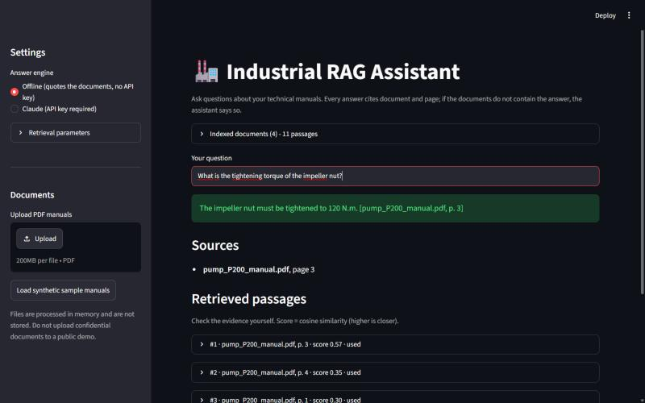

# Industrial RAG Assistant

Ask questions about industrial technical manuals (PDF) and get answers that **cite the document and page** they came from. When the documents do not contain the answer, the assistant says so instead of guessing.



## Why this exists

A general-purpose LLM asked "what is the tightening torque of the impeller nut?" will happily produce a plausible number. In a maintenance context a plausible-but-invented number is dangerous. This project implements Retrieval-Augmented Generation (RAG) from its basic components (no LangChain / LlamaIndex), with the focus on **verifiability**: every answer is tied to retrievable evidence, and the quality of the system is measured, not assumed.

## Features

- Upload one or more PDFs in a Streamlit UI (processed in memory, never stored), with a switchable Italian / English interface (`src/rag_assistant/i18n.py`).
- Page-aware extraction: every passage keeps its document name and page number.
- Configurable chunking, multilingual embeddings (Italian/English), exact FAISS vector search.
- Answers restricted to the retrieved evidence, with citations checked against the passages that were really retrieved.
- Explicit "not enough information" answers, from a similarity threshold plus the answering engine.
- Defences against prompt injection hidden in PDFs and conflict reporting between documents.
- Retrieved passages with similarity scores are always shown, so the user can check the evidence.
- **Page preview**: the cited PDF page is rendered with the passage used highlighted, so a citation can be checked at a glance.
- Answers containing technical values (torque, pressure, temperature...) carry a reminder to verify them on the cited page.
- One-click example questions (normal, Italian manual, conflicting documents, hidden instruction, no answer) and a built-in set of synthetic sample manuals, so the app can be tried without uploading anything.
- Three tabs: **Assistant**, **How it works** (explanation and flow diagram) and **Evaluation** (live view of `eval/results.json`, including the observed errors).
- Two interchangeable answer engines: an **offline extractive engine** (no API key) and **Claude** via the Anthropic API.
- 167 automated tests that run with no network and no API key, plus a repeatable evaluation.

## Quick start

Requires Python 3.10+ (developed and tested on 3.12).

```bash
git clone <your-repo-url> industrial-rag-assistant
cd industrial-rag-assistant
python -m venv .venv
# Windows: .venv\Scripts\activate      macOS/Linux: source .venv/bin/activate
pip install -e ".[app,dev]"
streamlit run app/streamlit_app.py
```

In the sidebar click **Load synthetic sample manuals** (or upload your own PDFs) and ask, for example:

- `What is the tightening torque of the impeller nut?`
- `Qual è la potenza del motore del compressore C-50?`
- `What is the maximum pressure of the pump?` (two documents disagree: both values are reported)
- `What is the warranty period of the P-200?` (not in the documents: the assistant declines)

The first run downloads the embedding model (~120 MB, 8-bit quantised) from Hugging Face. Behind a corporate proxy that re-signs TLS traffic and shows `CERTIFICATE_VERIFY_FAILED`, run `pip install -e ".[corp]"`: the app then uses the operating-system certificate store.

### Using Claude instead of the offline engine

Choose **Claude** in the sidebar and paste an API key (kept in memory only), or set it in the environment:

```bash
cp .env.example .env        # then edit .env; .env is git-ignored
export ANTHROPIC_API_KEY=...   # PowerShell: $env:ANTHROPIC_API_KEY="..."
```

The Claude engine is implemented and unit-tested against a fake provider, but **it has not been evaluated against the live API** in this repository's results (see Limitations).

### Tests, lint, evaluation

```bash
pytest                         # 167 tests, offline, no API key
ruff check . && ruff format --check .
python -m rag_assistant.evaluation --out eval/results.json    # needs the embedding model
python scripts/make_sample_pdfs.py                            # regenerate the sample PDFs
```

## Architecture

```mermaid
flowchart LR
    subgraph Ingestion [Once per PDF]
        A[PDF upload] --> B[pdf_loader<br/>pages + page numbers]
        B --> C[chunking<br/>overlapping chunks per page]
        C --> D[embeddings<br/>multilingual MiniLM, ONNX]
        D --> E[(FAISS index<br/>cosine similarity)]
    end
    subgraph Query [Every question]
        Q[Question] --> F[embed question]
        F --> G[retrieval<br/>top-k + scores]
        E --> G
        G --> H{generation<br/>score threshold<br/>+ injection filter}
        H -- no usable evidence --> N[Not enough information]
        H -- evidence --> I[Prompt: rules + untrusted sources]
        I --> J[LLM provider<br/>Claude or offline extractive]
        J --> K[Citation check<br/>[S1] -> document, page]
        K --> L[Answer + sources + passages]
    end
```

| Module | Responsibility |
|---|---|
| `pdf_loader.py` | PDF bytes → pages; typed errors for empty / corrupted / password-protected / text-less PDFs |
| `chunking.py` | Sliding window with overlap, cut on whitespace, never crossing a page boundary |
| `embeddings.py` | `Embedder` protocol; `FastEmbedEmbedder` (real) and `HashingEmbedder` (deterministic, for tests) |
| `index.py` | FAISS `IndexFlatIP` over unit vectors (inner product = cosine); add / remove document |
| `retrieval.py` | Question → top-k chunks with rank and score |
| `prompts.py` | System rules, source format, injection patterns |
| `llm.py` | `LLMProvider` protocol; `AnthropicProvider`, `ExtractiveProvider` |
| `generation.py` | Evidence selection, prompt building, citation verification |
| `pipeline.py` | Facade used by the UI and the evaluation |
| `i18n.py`, `i18n_content.py` | Italian / English interface strings (a test checks both languages have the same keys) |
| `preview.py` | Renders a cited PDF page with the used sentences highlighted |
| `evaluation.py` | Repeatable evaluation with four separate metrics |

## Design decisions

- **No RAG framework.** Each step is ~30–60 lines you can read and test. Abstractions can come later.
- **Citations are verified, not trusted.** The model sees sources labelled `S1…Sn` and cites those ids. The code maps each id back to the real document/page and reports ids that do not exist; an answer with no valid citation is flagged as unverifiable.
- **Chunks never cross pages**, so a citation is always exact.
- **Exact search (`IndexFlatIP`).** For a few thousand chunks, approximate indexes add complexity and no benefit.
- **ONNX embeddings (fastembed) instead of PyTorch, 8-bit quantised.** Much lighter to install and deploy; the multilingual model handles Italian and English. The first public deployment exceeded Streamlit Cloud's memory limit with the full-precision model (about 560 MB just for the model; ~790 MB for the process). The quantised export of the same model costs about 400 MB, and the whole app measured 636 MB (on Windows, after loading the sample manuals and asking a question). Its embeddings are close to the original (mean cosine 0.994 on a small sample) but retrieval got slightly worse on this benchmark (hit@1 0.80 → 0.77, hit@3 1.00 → 0.94). `FastEmbedEmbedder(quantized=False)` gives the original model.
- **Provider interface** (`complete(system, user) -> str`): swapping vendor means writing one small class.
- **Offline extractive engine.** Deterministic, always grounded (it only copies sentences from the sources), keyless: it makes the demo, the tests and the evaluation reproducible, and gives a baseline to compare a real LLM against.
- **Prompt-injection handling is layered**: (1) passages matching injection patterns are removed before prompting and shown as a warning; (2) the system prompt declares source text untrusted; (3) sources are escaped so a document cannot close the `<source>` tag; (4) citations are verified afterwards. This reduces the risk; it does not eliminate it.

## Evaluation

43 questions over 4 synthetic documents (`data/sample_pdfs/`, generated by `scripts/make_sample_pdfs.py`): 35 answerable and 8 not answerable. Categories: factual, procedure, Italian, safety, conflicting documents, prompt injection, unanswerable. Each question lists expected keywords and the gold document/page (`eval/questions.jsonl`).

Four metrics are reported separately. Default configuration: chunk 400 / overlap 80, top-k 5, similarity threshold 0.25, offline extractive engine:

| Metric | Result |
|---|---|
| Retrieval hit@1 / hit@3 / hit@5 (a gold page is among the results) | 0.77 / 0.94 / 1.00 |
| Retrieval MRR | 0.87 |
| Answer correct (expected keywords present, no forbidden content), answerable questions | 0.83 (29/35) |
| Citation hit (a cited page is a gold page), answered questions | 1.00 |
| Citation precision (cited pages that are gold) | 1.00 |
| Correct abstention on unanswerable questions | 0.75 (6/8) |
| False abstention on answerable questions | 0.17 (6/35) |

**The trade-off is real.** Raising the extractive engine's overlap threshold makes it refuse more unanswerable questions but also more answerable ones (same questions, similarity threshold 0.25):

| min overlap | answer correct | correct abstention | false abstention |
|---|---|---|---|
| 0.25 | 0.91 | 0.25 | 0.06 |
| 0.30 | 0.86 | 0.38 | 0.11 |
| 0.40 (default) | 0.83 | 0.75 | 0.17 |
| 0.45 | 0.77 | 0.75 | 0.23 |
| 0.50 | 0.69 | 1.00 | 0.31 |

For maintenance documentation a wrong answer is worse than a refusal, which is why the default leans towards refusing.

**What the evaluation showed**

- Vector similarity alone does **not** separate "no answer" from "answer": unanswerable questions on a covered topic (e.g. "weight of the C-50" scored 0.50, "viscosity of the P-200" 0.75) score as high as many answerable ones (lowest answerable top-1 score: 0.29). The similarity threshold only catches off-topic questions (0.10). Refusing on-topic questions requires the answering engine to notice that the specific fact is missing.
- Observed errors in the default run (listed by `python -m rag_assistant.evaluation`):
  - 6 false abstentions (q06, q08, q09, q23, q27, q28). They are lexical mismatches between the question and the manual: "lubricated" vs "Lubricate", "inspected" vs "Inspect", "replaced" vs "Replace" (no stemming), "How often…" vs a sentence saying "every 2000 hours", "compare" in the question but not in the alarm text. q28 also has a weak retrieval score (0.28). A real LLM should handle these paraphrases; the extractive engine cannot.
  - 2 unanswerable questions were answered (q41 "supply voltage of the compressor motor", q43 "price of the P-200"): the engine quoted a sentence that shares the topic or product name but not the asked fact.
- The conflict and injection questions behave as intended: both conflicting values are reported with their citations, and the injected "100 bar" never reaches the answer.
- A bug found by the evaluation and fixed: the first version dropped a whole passage when it contained one injected sentence, which also discarded legitimate facts next to it (fire assembly point, emergency number). Only the suspicious sentences are removed now (answer correct 0.74 → 0.83).

## Limitations (please read)

- **Small, synthetic, self-written benchmark.** 43 questions over 11 chunks. hit@5 = 1.00 is nearly trivial when the corpus has 11 chunks; hit@1 is the more informative number. These results do **not** show the system is reliable on real manuals.
- **Thresholds were tuned on the same questions used to report results**, so the numbers are optimistic. A proper evaluation needs a separate test set from real documents.
- **The Claude engine was not evaluated** against the live API here. Expected to be better at paraphrase and refusals, but that is unmeasured.
- The extractive engine cannot paraphrase, translate (a question in English over an Italian document retrieves well but is not answered) or combine facts.
- **No OCR.** Scanned PDFs are rejected with a clear message. Tables and multi-column layouts are extracted as plain text and may lose structure.
- No persistence: the index lives in the session and is rebuilt on restart. Exact search will not scale to very large collections.
- Prompt-injection defences are heuristic (pattern matching + prompt design) and can be bypassed.
- Not for safety-critical decisions: always verify against the cited page.

## Deploying a public demo on Streamlit Community Cloud

1. Push the repository to GitHub (check that `.env` is not tracked).
2. On [share.streamlit.io](https://share.streamlit.io) create an app from the repo: main file `app/streamlit_app.py`; dependencies are read from `requirements.txt`.
3. The first start downloads the embedding model; not verified on Cloud yet.

A public demo is visible to anyone with the URL: use only non-confidential documents. Users can paste their own API key in the sidebar; do not put your key in the app's public configuration.

## Project structure

```
app/streamlit_app.py      Streamlit UI
src/rag_assistant/        library (see table above)
tests/                    pytest suite (offline)
eval/questions.jsonl      evaluation set
data/sample_pdfs/         synthetic manuals
scripts/                  sample PDF generator
docs/STUDY_GUIDE.md       guide to every module (Italian)
```

## License

MIT, see [LICENSE](LICENSE). The sample documents are invented for this project.
